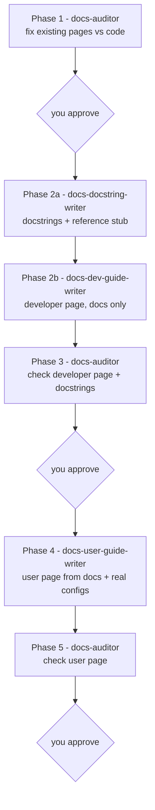

# Documentation automation: how it works and how to run it

This guide explains the agent setup that rewrites the d3tools documentation into a
**User Guide** and a **Developer Guide**, and how to drive it step by step. It assumes
no previous experience with agents.

---

## 1. The mental model

An "agent" here is just Copilot Chat running with a **fixed job description**: a markdown
file that says what it is for, which tools it may use (read files, edit files, run
commands...), and what it must hand back. You pick it from the dropdown in the Chat view
instead of the default "Agent", type a short instruction, and it works until it's done.

Why several agents instead of one long chat?

- **Focus.** Each agent does one job on one topic, so its context isn't full of unrelated
  pages and it doesn't skim.
- **Independent checking.** The writers are *not allowed* to read the source code. They
  write only from the documentation, so anything the docs leave out turns into an
  explicit "open question" instead of being quietly filled in from the code. A separate
  auditor then checks the result against the code and tests. That's your original idea,
  and it's the main reason this setup is useful.
- **You stay in control.** Nothing moves to the next phase until you've read the findings
  and approved them.

There are three kinds of pieces:

| Piece | What it is | Deterministic? |
|-------|------------|----------------|
| Agents (`.agent.md`) | Job descriptions for the LLM | No: they can make mistakes |
| Instructions (`.instructions.md`) | Shared rules added automatically whenever `docs/**` is involved | No |
| Scripts / hooks | Plain Python that checks or blocks things | Yes |

The scripts catch mistakes the LLM can't be trusted to spot: invalid JSON, configs that
don't parse, broken links, imports of names that don't exist.

---

## 2. What was created

```
d3tools/
├── .github/
│   ├── instructions/
│   │   └── docs.instructions.md      shared rules: two tiers, topics, style, known facts
│   ├── agents/
│   │   ├── docs-orchestrator.agent.md       runs phases, calls the others, stops for you
│   │   ├── docs-auditor.agent.md            phases 1, 3, 5: check docs vs code, fix docs
│   │   ├── docs-docstring-writer.agent.md   phase 2a: docstrings -> API reference
│   │   ├── docs-dev-guide-writer.agent.md   phase 2b: developer guide, docs-only
│   │   └── docs-user-guide-writer.agent.md  phase 4: user guide, docs + real configs only
│   └── hooks/
│       └── docs_only_guard.py        blocks the two writers from reading src/, tests/, build/
├── scripts/
│   ├── check_docs.py                 mechanical checks on docs/ (JSON, Python, links)
│   └── docs_topic_worktree.py        guarded per-topic branch/worktree setup
├── mkdocs.yml                        site config; builds the API reference from docstrings
└── _working_summaries/
    ├── docs_automation_guide.md      this file
  ├── docs_topic_inventory.md       source/test/page ownership for every topic
    └── findings/
        └── approved.md               you list approved phases here
```

### The shared rules (`docs.instructions.md`)

Every docs agent reads this file, and so does normal Copilot Chat whenever you work on
files in `docs/`. It contains:

- **The tier rule:** if it can be set in JSON, env vars, the CLI or `wf.run()`, it goes
  in the User Guide; if it needs Python against d3tools classes, it goes in the Developer
  Guide. So fallbacks are User Guide and parents are Developer Guide.
- The list of **topics** and which existing pages hold each one.
- The **verification rules** (code and tests are the truth; `build/` is a stale copy
  and must never be used).
- The **style**, with `thumbnails/overview.md` as the model.
- **Known verified facts**, so agents don't re-argue them.

When you learn something new and important (for example "this key is deprecated"), add
it under "Known facts". Every later run will then respect it.

### `check_docs.py`

```bash
cd /home/luca/Documents/CIMA_code/d3tools
/home/luca/Documents/CIMA_code/workspace_env/.venv/bin/python scripts/check_docs.py            # all docs
/home/luca/Documents/CIMA_code/workspace_env/.venv/bin/python scripts/check_docs.py docs/datasets
```

For every markdown file it checks:

| Check | What it does |
|-------|--------------|
| `json` | every ```` ```json ```` block must be valid JSON |
| `workflow` | if a JSON block looks like a full workflow config (all top-level keys are reserved keys or section aliases), it is parsed with `WorkflowDefinition(..., build_workflow_objects=False)` in a temp folder, with dummy values for missing `{ENV.X}` |
| `workflow-env` | a WARN, not an error: the config needs something missing on this machine (a `/var/log` folder, an S3 host...) |
| `python` | every ```` ```python ```` block must compile, and every `d3tools`/`door`/`dam`/`dryes` import in it must exist |
| `link`, `anchor` | relative links must point to existing files and existing headings |

If a snippet is *meant* to be partial (with `"..."` placeholders), put
`<!-- check-docs: skip -->` on the line directly before the ```` ``` ```` fence.

Run the checker on each topic's pages to establish its own baseline; the error
count changes as topics are audited. A missing page is reported as a gap finding
rather than passed as an empty checker run.

### The hook (`docs_only_guard.py`)

The two writer agents have this hook in their frontmatter. Before each tool call, VS
Code sends the call to the script. If the call touches `d3tools/src`, `d3tools/tests` or
`d3tools/build`, the script answers "deny" with a message telling the agent to record an
open question instead.

---

## 3. One-time setup

1. **Install the docs site tools** into the shared venv (needed from phase 2a on):

   ```bash
   cd /home/luca/Documents/CIMA_code/workspace_env
   uv pip install --python .venv/bin/python mkdocs-material "mkdocstrings[python]"
   ```

   If you want them to be permanent, add them to `workspace_env/pyproject.toml` or as a
   `docs` extra in `d3tools/pyproject.toml`.

2. **Commit the automation setup on `docs`** before spawning topic branches.
  New worktrees start from the committed `docs` tip and need these agent files:

   ```bash
   cd /home/luca/Documents/CIMA_code/d3tools
  git status --short --branch
   git add .github/agents/docs-orchestrator.agent.md .github/agents/docs-auditor.agent.md \
     .github/instructions/docs.instructions.md .gitignore scripts/docs_topic_worktree.py \
     tests/test_docs_topic_worktree.py _working_summaries/docs_topic_inventory.md \
     _working_summaries/docs_automation_guide.md
  git diff --cached
  git commit -m "Set up isolated documentation topic audits"
   ```

  The primary checkout must be clean and on `docs`. Do not create a new
  `docs` branch or switch away from the existing integration checkout. The
  `.gitignore` exception exposes new `findings/phase*.md` files to Git; review
  any pre-existing untracked findings (including an old phase-1 datasets
  report) before provisioning. Do not move or delete them automatically.

3. **Check that VS Code sees the agents.** Open the Chat view and click the mode/agent
   dropdown (where it says "Agent", "Ask"...). You should see `docs-orchestrator`,
   `docs-auditor`, etc. If not:
   - use "Configure Custom Agents..." in that dropdown to see which files were found;
   - in this multi-root workspace the files live in the `d3tools` folder's `.github/`;
     if they aren't picked up, open `d3tools` on its own as a test.

4. **Check that the hook is active.** Pick `docs-dev-guide-writer` and type:
   *"Read src/d3tools/data/__init__.py and tell me its first line."* It should be denied.
   If it reads the file, hooks aren't enabled in your VS Code version/settings. See
   Troubleshooting. The setup still works, but the "docs only" rule is then only a
   polite request.

---

## 4. The pipeline



This runs **per topic**. Phase 1 can be run independently for the source topics
in the [topic inventory](docs_topic_inventory.md); each topic has its own branch
and worktree. `getting-started` is a cross-topic review and should wait until
the source-topic phase-1 branches have been merged.

Suggested integration order after independent audits:

1. `configuration`
2. `datasets`
3. `timestepping`
4. `workflow-sections`
5. `logging`
6. `thumbnails` (already close to the gold standard, so it should be quick)
7. `notification` (short; marked experimental)
8. `getting-started` (last; phases 1, 4, 5 only)

Also cover `spatial`, `cases`, `parsing`, and `utilities`. They have no existing
pages: their phase-1 output is a findings inventory, not invented documentation.
Their source and test boundaries are listed in the topic inventory.

You don't have to finish all phases of one topic before starting the next. A good rhythm
is **phase 1 for every source topic in isolated worktrees**, then review and merge
each branch into `docs` before phases 2-3, then 4-5. Distinct worktrees prevent
simultaneous audits from mixing edits, but merges may still conflict and require review.

### What each phase produces

| Phase | Output files | What you review |
|-------|--------------|-----------------|
| 1 | edits to existing pages, `findings/phase1-<topic>.md` | the findings table and `git diff docs/` |
| 2a | docstring edits in `src/`, `docs/developer/reference/<topic>.md` | `git diff src/` (must be docstrings only!) |
| 2b | `docs/developer/<topic>.md`, open questions | does it read well? are the questions sensible? |
| 3 | fixes to 2a/2b, `findings/phase3-<topic>.md` | findings table, `code-bug?` rows |
| 4 | `docs/user-guide/<topic>.md`, open questions | read it as a user would |
| 5 | fixes to 4, `findings/phase5-<topic>.md` | findings table |

### The findings file

Every auditor run writes a table **before** changing anything:

| # | Doc location | Claim | Evidence | Verdict | Action |
|---|--------------|-------|----------|---------|--------|
| 3 | tags.md:136 | `{DATASETS.x, v='a'}` works | config_resolution.py:78 | wrong | use `{x, v='a'}` |

Verdicts: `correct`, `wrong`, `missing`, `unverified` (in the code but no test covers
it), `code-bug?`, `wrong-tier`.

The **`code-bug?` rows matter most for you.** They're places where the agent thinks the
*code* is wrong. It doesn't touch those; you decide whether to fix the code (and then
re-run the audit) or accept the behaviour (and tell the agent to document it).

---

## 5. Running it

### Branch and worktree setup

First commit the automation rules, inventory and provisioning script on `docs`.
The script refuses to run while the primary `docs` checkout is dirty. For a
topic T it uses branch `docs_<T>` and sibling directory `../d3tools-docs-<T>`:

```bash
cd /home/luca/Documents/CIMA_code/d3tools
/home/luca/Documents/CIMA_code/workspace_env/.venv/bin/python scripts/docs_topic_worktree.py configuration timestepping cases
```

Each new branch starts at the current `docs` commit. The existing
`docs_datasets` branch is **attached**, not recreated or reset; if it already has
phase-1 findings, do not run that audit again unless you deliberately request
another pass. Worktrees are beside the primary checkout, not inside it. The
script refuses dirty or conflicting existing worktrees. It does not run an
agent, commit, approve, merge, or delete anything.

You can inspect an individual result with:

```bash
git -C ../d3tools-docs-timestepping status --short --branch
git -C ../d3tools-docs-timestepping diff -- docs/timestepping.md
```

The orchestrator provisions these worktrees before phase 1 and passes each
auditor its absolute worktree path and owned page list. Use separate VS Code
windows or sessions for truly concurrent agent runs if the current agent host
cannot launch subagents simultaneously. A shared checkout does not become
parallel merely by creating branches. If the agent's editor tools cannot reach
a sibling worktree, add that folder to the VS Code workspace or open it in its
own window before delegating; never fall back to editing the primary checkout.

### Review and merge a phase-1 topic

1. Read that worktree's `findings/phase1-<topic>.md` and review only its owned
  page diff. Resolve `code-bug?` decisions before approval.
2. Run `scripts/check_docs.py` for that topic from **its worktree** (for topics
  with no pages, review the gap findings instead). Check `git status --short`
  for unexpected changes.
3. Record `phase1-<topic>` in that branch's `findings/approved.md`, stage only
  reviewed pages and findings, inspect `git diff --cached`, then commit there.
4. Merge the reviewed topic branch into `docs` yourself. Resolve any conflict
  there, rerun the checker on affected pages, and keep the other topic branches
  intact. Approval and merge are human decisions, not orchestrator steps.

If you disagree with a finding, send the auditor back to the same topic
worktree with the row number and why it needs rechecking. Never use a broad
`git restore docs/` or `git clean -fd docs/` to discard unreviewed work.

### Using the orchestrator

Once the individual agents behave, let the orchestrator do the calling:

1. Dropdown -> **docs-orchestrator**.
2. Examples of what to type:
  - `phase 1 for configuration, workflow-sections and logging` (isolated topic worktrees)
  - `status` (checks each topic branch's findings and approval file)
   - `phase 2 for datasets` (runs 2a, then 2b, then stops)
   - `phase 3 for datasets`
3. It delegates into the worktree for each topic, runs the checker there, and gives
  you separate reports. The subagents may execute concurrently when supported;
  otherwise they execute sequentially, still in isolated worktrees. It **always
  stops** after one phase and never merges or goes further unless you approved
  the previous phase (in the chat or in `approved.md`).

Subagents run in their own context and only hand back their final report. You won't see
their reasoning in the chat, only the orchestrator's summary. The files they wrote are
the real output, so review them the same way as above.

### Assembling the final docs

Once all topics are through phase 5 (this last step is best done in a normal chat with
you watching):

1. Rewrite `docs/index.md` as the entry point, with two paths: "I write workflow
   configs" -> `user-guide/`, and "I build on d3tools in Python" -> `developer/`.
2. Delete the old source-material pages (`docs/configuration/`, `docs/datasets/`,
   `docs/logging/`, `docs/examples/`, `docs/timestepping.md`, ...) once their content has
   an owner in the new tiers. Run the checker afterwards to catch dangling links.
3. `mkdocs build --strict` must pass; `mkdocs serve` gives a local preview at
   http://127.0.0.1:8000.
4. Delete `_working_summaries/documentation_status.md` (it describes the old docs).

---

## 6. Tips

- **Keep instructions short and concrete.** If an agent keeps making the same mistake,
  add one line to `docs.instructions.md` ("Known facts") rather than correcting it each
  time.
- **Smaller is better.** If a topic is large (datasets has 8 pages), run phase 1 on half
  the pages at a time: `phase 1, topic datasets, only docs/datasets/operations.md and
  formats-and-mixins.md`.
- **Commit per approved topic and phase, in its topic worktree.** This keeps
  diffs attributable and leaves `docs` as the reviewed integration branch.
- **Read the open questions.** They show what the docs don't explain. A question from the
  user-guide writer means a real user would get stuck at the same point.
- **Check the `src/` diff after phase 2a/3.** It must contain docstring changes only. If
  a line of code changed, discard that hunk.
- **Tests still pass:**
  `/home/luca/Documents/CIMA_code/workspace_env/.venv/bin/python -m pytest tests -q`.

---

## 7. Troubleshooting and limits

| Symptom | Cause / fix |
|---------|-------------|
| Agents don't appear in the dropdown | See setup step 3. Frontmatter must be valid YAML between `---` lines. |
| Writer reads `src/` anyway | Hooks not active in your VS Code build. Check the Chat hooks settings/preview flag. Until then the rule is only an instruction. |
| Writer quotes code it shouldn't know | Semantic "search" can return code snippets without opening a file, and the hook can't block that. The auditors will still catch wrong claims, so this isn't fatal. |
| Checker reports `workflow-env` warnings | The example uses paths or hosts that don't exist locally. Fine as long as it's an ERROR-free WARN. |
| Checker ERROR on a snippet that's meant to be partial | Add `<!-- check-docs: skip -->` on the line before the fence. |
| Orchestrator refuses to start a phase | The previous phase isn't in `findings/approved.md` and you didn't approve it in the chat. |
| Agent edited files it shouldn't have | Inspect that topic worktree's diff and decide which edits to keep. Never reset or clean another topic's worktree. Tighten the agent's page-owner rule before rerunning. |
| The hook blocks too much or too little | Edit the `BLOCKED` regex in `.github/hooks/docs_only_guard.py` and test it with `echo '{"tool_input":{"filePath":"..."}}' \| python .github/hooks/docs_only_guard.py` |

---

## 8. Glossary

- **Agent / custom agent:** a `.agent.md` file: a named job description with allowed
  tools. Selectable in the Chat dropdown.
- **Subagent:** an agent called by another agent (here, by the orchestrator). It works in
  a separate context and returns a single report.
- **Instructions file:** rules automatically added to the chat when matching files
  (`applyTo: "docs/**"`) are involved.
- **Hook:** a script VS Code runs at a fixed point (here, before every tool call) that
  can allow or deny the action. The only piece here that is enforced rather than
  requested.
- **mkdocs / mkdocstrings:** mkdocs builds a website from `docs/`; mkdocstrings turns a
  line like `::: d3tools.data.dataset` into a full API page generated from docstrings.
  That's why the API reference is never hand-written.
