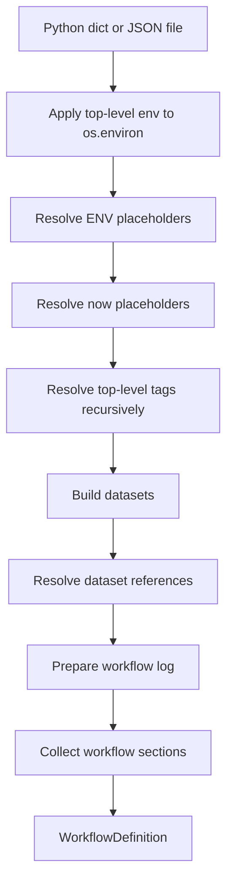

# Configuration Developer Guide

The configuration package turns workflow options into the objects consumed by d3tools
execution. It accepts either a Python `dict` or JSON loaded through
`WorkflowDefinition.load()`, then applies the same parsing pipeline to environment
values, time values, tags, datasets, logging, and workflow sections.

## Responsibility and Boundaries

Configuration owns the order in which workflow input is prepared and the conversion
from declarative options into workflow objects:

- `WorkflowDefinition.load()` is the JSON-file entry point.
- `parse_options()` applies the configuration pipeline to an options mapping.
- The pipeline builds datasets and resolves references before collecting workflow
  sections.
- Workflow sections are handed to the selected engine. Engine-specific case options
  are not interpreted by the configuration layer; see the
  [Workflow Sections guide](../configuration/workflow-sections.md).

Dataset option details and dataset update behaviour belong to the
[Datasets guide](../configuration/datasets.md). Workflow logging details belong to
the [Logging guide](../logging/overview.md).

## Parsing Lifecycle

The parser processes an options mapping in this order:



The ordering is part of the configuration contract. Environment values are applied
before environment placeholders are resolved. Environment and time values can feed
tags, and those resolved tags can feed dataset definitions. Dataset objects do not
exist during tag resolution, so tags cannot refer to datasets.

The `workflow_log.file` time placeholder is deferred until the workflow runs. This
allows the filename to use the actual run time rather than the time at which the
configuration was parsed.

## Python Entry Points

Load a JSON workflow and run it through the normal workflow API:

```python
from d3tools import WorkflowDefinition

workflow = WorkflowDefinition.load("workflow.json")
workflow.run(start="2024-01-01", end="2024-12-31")
```

A Python mapping can be prepared by application code and passed through the same
configuration machinery with `parse_options()`. Keep the mapping equivalent to the
JSON shape expected by the User Guide; the parser does not introduce a separate
Python configuration model.

```python
from d3tools.config.parsing_pipeline import parse_options

options = {
    "workflow_name": "daily_download",
    "tags": {"source": "ERA5"},
    "datasets": {},
    "door_downloader": {"engine": "door"},
}

parsed_options = parse_options(options)
```

The exact public constructor and parser APIs, including their documented parameters,
are listed in the [configuration API reference](reference/configuration.md).

## Resolution Rules Relevant to Python Code

When Python code constructs or modifies an options mapping, preserve these rules:

- Top-level keys reserved by d3tools are treated as configuration controls. Other
  top-level keys are interpreted as workflow sections and must resolve to a recognised
  engine.
- The recognised engines are `door`, `dam`, and `dryes`.
- Dataset references can use a bare dataset key or a prefixed form. A prefixed form
  only resolves when its prefix matches the literal top-level key in the mapping.
- An unresolved dataset reference remains a string unless it includes update tags,
  in which case the documented failure is an `AttributeError`.
- A top-level tag whose value is a list expands a containing string into a list of
  rendered strings.
- The top-level `env` value may be `None` or a mapping. Other values raise
  `TypeError`; mapping values are converted to strings when copied into
  `os.environ`.

For the complete user-facing syntax and examples, use the
[Configuration User Guide](../configuration/overview.md), [Tags](../configuration/tags.md),
and [Environment Variables](../configuration/environment.md) pages.

## Extension Surface

The documented Python extension surface for configuration is the ability to create
workflow options as a mapping and pass them through the normal `WorkflowDefinition`
and parser APIs. Section payloads are then consumed by the selected door, dam, or
dryes engine. Engine-specific configuration are implemented and documented in
the corresponding engine project.

## API Reference

See the generated [configuration API reference](reference/configuration.md) for the
public objects and modules in:

- `d3tools.config.options`
- `d3tools.config.parsing_pipeline`
- `d3tools.config.parsers`