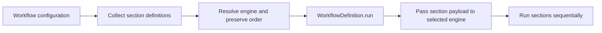

# Workflow Sections

Workflow sections are d3tools' orchestration boundary between a parsed workflow and
the `door`, `dam`, and `dryes` engines. d3tools collects section definitions and
preserves their order; each engine owns the meaning and validation of its section
payload. This page covers the Python-facing orchestration contract. JSON options and
engine-specific payloads belong in the [User Guide](../user-guide/workflow-sections.md).

## Lifecycle



The parser scans ordinary top-level section keys in insertion order. It recognizes
the documented aliases for the three engines, or uses an explicit section engine
and then the workflow-level default where applicable. A list-valued section is
flattened into separate numbered sections in list order. `workflow_sections` is the
resulting internal parsed-workflow field; it is not an alternate JSON input format.

At runtime, `WorkflowDefinition.run()` supplies the workflow's resolved time range
to its sections and dispatches each payload to the selected engine. Sections run
sequentially, and execution stops if a section fails. Range selection, section
options, engine aliases, and their configuration precedence are documented in the
[User Guide](../user-guide/workflow-sections.md). When workflow logging is enabled,
workflow and section execution events are recorded; see the [Logging Guide](../logging/overview.md).

## Python Integration

Code that already has a `WorkflowDefinition` can supply a run range through the
Python API:

```python
# workflow_definition is a WorkflowDefinition obtained by the host application.
workflow_definition.run(start=start, end=end)
```

The Python API also accepts a `TimeRange` in place of `start` and `end`; the two
forms cannot be combined. The [API reference](reference/workflow-sections.md)
documents the available `WorkflowSection` and `WorkflowDefinition` members.

## Extension Boundary

d3tools selects an engine and forwards its section payload; the engine-specific
schema and execution behavior are owned by `door`, `dam`, or `dryes`. The available
documentation describes those three engines and does not establish a general
third-party engine plugin contract. Treat new engine integrations or changes to
section construction as changes to this boundary, rather than as arbitrary new
workflow keys.