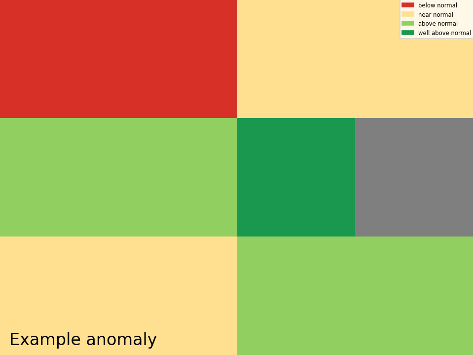

# Thumbnails

The `d3tools.thumbnails` package turns classified raster or vector data into
PNG previews. It provides three entry points:

| API | Use it for |
| --- | --- |
| `Thumbnail` | Render one raster or vector source directly. |
| `ThumbnailCollection` | Render several raster files and combine them into a PNG grid or multipage PDF. |
| `DatasetThumbnailManager` | Resolve colours, destinations, and overlays through Dataset objects. |

Install the optional dependencies before using these APIs:

```bash
pip install "d3tools[thumbnails]"
```

Raster paths also rely on the geospatial raster dependencies used by d3tools.

## Define colours and classes

Every thumbnail uses a QGIS-style text file with one class per line:

```text
position,r,g,b,a,label
-1,215,48,39,255,below normal
0,254,224,144,255,near normal
1,145,207,96,255,above normal
inf,26,152,80,255,well above normal
```

The header is illustrative only: because it is not a valid colour row, the
parser ignores it. Each valid row contains:

| Field | Meaning |
| --- | --- |
| `position` | Numeric upper class boundary, or `inf` for the final unbounded class. |
| `r`, `g`, `b`, `a` | Integer colour channels from 0 through 255. |
| `label` | Legend text; commas after the first five fields remain part of the label. |

Rows are sorted by numeric position, with `inf` last. Classification is
right-closed: a boundary value belongs to the class ending at that boundary.
With boundaries `-1`, `0`, `1`, and `inf`, for example, `-1` is in the first
class and `-0.5` is in the second. Missing values use a separate grey class.

The example colour file is available at
[`docs/assets/thumbnails/anomaly-colors.txt`](../assets/thumbnails/anomaly-colors.txt).

### Parse and construct colour maps

`parse_line()` validates one line. `parse_colors()` reads a path or Dataset,
ignores malformed lines, sorts the valid definitions, and raises `ValueError`
if none remain.

```python
from d3tools.thumbnails.colors import parse_colors, parse_line

position, rgba, label = parse_line("1,145,207,96,255,above normal")
assert position == "1"
assert rgba == ["145", "207", "96", "255"]
assert label == "above normal"

positions, colors, labels = parse_colors(
    "docs/assets/thumbnails/anomaly-colors.txt"
)
assert positions == ("-1", "0", "1", "inf")
assert labels[-1] == "well above normal"
```

`create_colormap()` converts ordered 0–255 RGBA values to a Matplotlib
`ListedColormap`. By default it appends grey for missing data.
`keep_used_colors()` selects the contiguous palette range between the minimum
and maximum observed class indices; it does not remove unused classes inside
that range.

## Render raster data

`Thumbnail` accepts either a raster path or an `xarray.DataArray`. After
singleton dimensions are squeezed, the data must be two-dimensional; select a
band or time slice before constructing the renderer if necessary.

```python
from pathlib import Path
from tempfile import TemporaryDirectory

import numpy as np
import xarray as xr

from d3tools.thumbnails import Thumbnail

values = xr.DataArray(
    np.array(
        [
            [-2.0, -1.0, -0.5, 0.0],
            [0.5, 1.0, 1.5, np.nan],
            [-0.75, -0.25, 0.25, 0.75],
        ]
    ),
    dims=("y", "x"),
)

renderer = Thumbnail(
    values,
    "docs/assets/thumbnails/anomaly-colors.txt",
)

with TemporaryDirectory() as directory:
    output = Path(directory) / "preview.png"
    saved = renderer.save(
        str(output),
        annotation="Example anomaly",
        legend={"loc": "upper right", "fontsize": 7},
        dpi=120,
    )
    assert saved == str(output)
    assert output.stat().st_size > 0
```

The same data produces this preview:



Raster paths are opened with `rioxarray.open_rasterio()`. Their transform
controls the plotted extent, and their nodata value is classified as missing.
A DataArray can also declare nodata through its `.rio` accessor. A fully
missing source produces a grey `No data` image and skips overlays,
annotations, and legends.

### Save options

`Thumbnail.save(destination, **options)` creates missing parent directories,
stores the destination as `thumbnail_file`, and closes its Matplotlib figure
after writing. The recognized options are:

| Option | Accepted value | Behaviour |
| --- | --- | --- |
| `dpi` | Number | Output resolution; otherwise inferred. |
| `size` | Number | Scale applied to source dimensions; otherwise inferred. |
| `shape` | `(height, width)` | Overrides the render shape. |
| `vector_short_side` | Positive integer | Vector target for the shorter side; default `900`. |
| `vector_max_long_side` | Positive integer | Vector cap for the longer side; default `2400`. |
| `annotation` | String, mapping, `False`, or `None` | Add, configure, or disable annotation text. |
| `legend` | `True`, mapping, `False`, `None`, or `"none"` | Enable, configure, or disable the legend. |
| `overlay` | Path, Dataset, GeoDataFrame, mapping, `False`, or `None` | Draw vector boundaries over the source. |

For a raster path, annotation is inferred from the filename when the option is
omitted. For a DataArray, it is inferred from `attrs["source_key"]` when
present. Pass `annotation=False` to suppress it. A mapping may contain `text`
plus any options accepted by Matplotlib `Axes.annotate()`.

The legend is enabled by default and contains all definitions in the colour
file, not only classes present in the source. A legend mapping is passed to
Matplotlib `Axes.legend()`; `bbox_to_anchor` is discarded for compatibility
with older callers.

## Render vector data

Direct vector input must be a non-empty `geopandas.GeoDataFrame` with a
numeric column named `value`. Its geometries are coloured by the same
right-closed classification rules as raster cells.

```python
from pathlib import Path
from tempfile import TemporaryDirectory

import geopandas as gpd
from shapely.geometry import box

from d3tools.thumbnails import Thumbnail

features = gpd.GeoDataFrame(
    {"value": [-1.5, -0.5, 0.5, 1.5]},
    geometry=[
        box(0, 0, 1, 1),
        box(1, 0, 2, 1),
        box(0, 1, 1, 2),
        box(1, 1, 2, 2),
    ],
    crs="EPSG:4326",
)

renderer = Thumbnail(
    features,
    "docs/assets/thumbnails/anomaly-colors.txt",
)

with TemporaryDirectory() as directory:
    output = Path(directory) / "regions.png"
    renderer.save(str(output), annotation=False, legend=True)
    assert output.is_file()
```

For a differently named value field, rename it before direct rendering. The
Dataset manager offers a `field` option that performs this selection for you.
Vector dimensions are derived from total bounds and preserve the source aspect
ratio subject to the short-side target and long-side cap.

Empty vector data, a missing `value` column, or a non-numeric value column
raises `ValueError`.

## Add an overlay

An overlay may be a vector path, a `GeoDataFrame`, a Dataset returning vector
data, or a mapping containing `shp_file` and GeoPandas plotting options. Both
the source and overlay require a CRS. The overlay is reprojected to the source
CRS and drawn as boundaries; defaults are transparent fill, black edges, and
line width `0.5`.

```python
from pathlib import Path
from tempfile import TemporaryDirectory

import geopandas as gpd
import numpy as np
import xarray as xr
from rasterio.transform import from_origin
from shapely.geometry import box

from d3tools.thumbnails import Thumbnail

values = xr.DataArray(
    np.array([[-1.5, -0.5], [0.5, 1.5]]),
    dims=("y", "x"),
).rio.write_crs("EPSG:4326").rio.write_transform(from_origin(0, 2, 1, 1))
boundary = gpd.GeoDataFrame(
    geometry=[box(0, 0, 2, 2)],
    crs="EPSG:4326",
)

renderer = Thumbnail(values, "docs/assets/thumbnails/anomaly-colors.txt")

with TemporaryDirectory() as directory:
    output = Path(directory) / "overlay.png"
    renderer.save(
        str(output),
        overlay={
            "shp_file": boundary,
            "edgecolor": "white",
            "linewidth": 2,
        },
        annotation=False,
        legend=False,
    )
    assert output.is_file()
```

The mapping form must contain `shp_file`. Use `overlay=False` or `None` to
disable a configured overlay.

## Combine several raster thumbnails

`ThumbnailCollection` accepts raster file paths and either one shared colour
file or an equally sized list of colour files. It renders each source and
combines the results:

<!-- check-docs: skip -->
```python
from d3tools.thumbnails import ThumbnailCollection

collection = ThumbnailCollection(
    ["data/anomaly_202401.tif", "data/anomaly_202402.tif"],
    "docs/assets/thumbnails/anomaly-colors.txt",
)
collection.save(
    "output/anomaly-series.png",
    grid=(2, 1),  # columns, rows
    legend=False,
)
```

PNG output uses `(columns, rows)` and chooses a roughly square layout when
`grid` is omitted. If rendered image dimensions differ, the collection writes
a multipage PDF with the same basename instead. A `.pdf` destination always
creates a multipage PDF. The destination must include a parent directory;
missing eligible images raise `ValueError`.

Collection rendering currently accepts raster paths, rather than DataArrays
or GeoDataFrames, because its constructor creates one path-based `Thumbnail`
per item.

## Generate thumbnails through a Dataset

`DatasetThumbnailManager` is the Dataset-oriented wrapper. It holds Dataset
references for the colour definition and output destination, optionally an
overlay Dataset, and the same rendering options accepted by `Thumbnail.save()`.
`make_thumbnail()` resolves those paths using its keyword context, saves the
image, and returns the `Thumbnail` instance.

```python
from d3tools.data import Dataset
from d3tools.thumbnails import DatasetThumbnailManager

colors = Dataset.from_options(
    {
        "type": "local",
        "key_pattern": "docs/assets/thumbnails/anomaly-colors.txt",
    }
)
destination = Dataset.from_options(
    {"type": "local", "key_pattern": "output/preview.png"}
)

manager = DatasetThumbnailManager(
    colors=colors,
    destination=destination,
    annotation={"text": "Anomaly"},
    legend={"loc": "lower left"},
)

assert manager.colors is colors
assert manager.destination is destination
```

The manager also accepts a dictionary whose empty-string key contains a
DataArray. For a GeoDataFrame, `field="risk"` selects and renames that numeric
column to `value` before direct rendering.

When a Dataset is constructed from configuration, its `thumbnail` mapping is
converted into this manager. See [Datasets — Dataset-driven
thumbnails](datasets.md#dataset-driven-thumbnails) for Python attachment and
write ordering, and [Workflow orchestration — Configure
thumbnails](../workflow_orchestration/datasets.md#configure-thumbnails) for
the JSON form.

## Errors and practical limits

- Unsupported source types raise `TypeError`; raster sources that remain
  multidimensional after squeezing raise `ValueError`.
- Invalid colour rows are silently skipped. Validate configuration early with
  `parse_colors()` so a partially malformed file is not mistaken for a full
  palette.
- A colour file with no valid rows raises `ValueError`.
- Overlay reprojection requires a CRS on both inputs.
- Thumbnail rendering loads and classifies the source in memory. Select only
  the band, time, and spatial region needed for the preview.
- `save()` closes its temporary Matplotlib figure even when rendering fails;
  call it again to render another output.
- `DatasetThumbnailManager.from_dict()` returns `None` when either `colors` or
  `destination` is missing.

For complete signatures and lower-level members, see the
[Thumbnails API reference](../reference/thumbnails.md).
