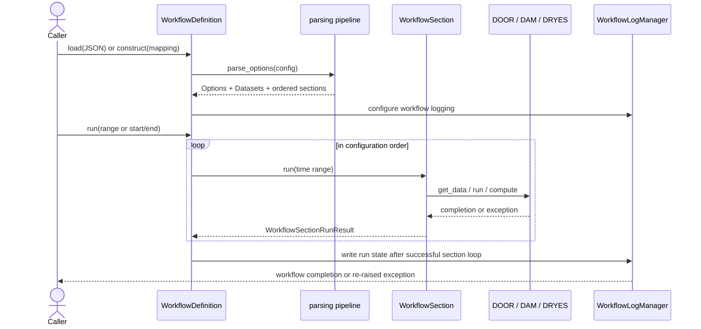

# Workflow lifecycle

This page follows a workflow from JSON or a Python mapping through parsing,
engine dispatch, logging, and cleanup. It is intended for maintainers and
integrators diagnosing behaviour below the operator-facing
[configuration](../configuration.md) and [workflows](../workflows.md) pages.
Engine payload schemas and domain processing remain the responsibility of
DOOR, DAM, and DRYES.

## Lifecycle at a glance



The main ordering guarantees are:

1. Configuration stages run in a fixed sequence.
2. Sections preserve their order from the input mapping; list entries preserve
   list order.
3. Sections execute sequentially. An exception stops later sections.
4. Workflow and section logging contexts re-raise exceptions after recording
   them.

## Workflow loading and parsing

`WorkflowDefinition.load()` reads and merges one or more JSON files before
constructing a `WorkflowDefinition`. Constructing the class directly accepts
the same declarative shape as a Python mapping. Both paths call
`parse_options()`, which applies these stages in order:

1. Copy values from the top-level `env` mapping into `os.environ` as strings.
2. Resolve `{ENV.NAME}` placeholders recursively.
3. Resolve every `{now}` placeholder using one timestamp for this parser call.
4. Resolve top-level tags against each other, then substitute them recursively
   throughout the configuration.
5. Construct each dataset definition as a `Dataset`, applying the optional
   `datasets.__defaults__` mapping.
6. Replace whole-value dataset references with those objects; references with
   tag assignments use `Dataset.update()`.
7. Normalise and validate the `workflow_log` value without creating the
   logging manager yet.
8. Convert every non-reserved top-level entry into one or more ordered
   `WorkflowSection` objects and remove the original entries.

This order is a dependency contract. Environment values can feed time and tag
placeholders, and resolved tags can feed dataset definitions. Tags cannot
depend on dataset objects because datasets do not exist during tag resolution.
Unresolved ordinary tags remain strings; a missing environment value without
a default raises during parsing.

The result is an `Options` mapping containing resolved tags, constructed
datasets, normalised workflow controls, and `workflow_sections`. A
`WorkflowDefinition` retains that mapping as `options` and exposes the main
parts as `tags`, `datasets`, `workflow_sections`, and `other_options`.

Parsing does not keep a cross-workflow result cache: a new definition parses
its input again. The resulting objects remain attached to that definition.
Separately, dataset key handling uses `KeyParser`, which caches matcher
metadata by key pattern; this does not cache workflow configuration or engine
results.

## Resolution helpers

The pipeline is composed from smaller helpers, but they do not form a second
configuration language:

- `set_env()` rebuilds nested dictionaries and lists while replacing
  environment placeholders. Missing values without a non-empty default raise
  `ValueError`.
- `substitute_string()` renders a single string from a tag mapping. It supports
  plain and formatted placeholders and expands list-valued tags.
- `substitute_values()` applies string substitution recursively to mapping
  keys, values, and list items.
- `set_dataset()` replaces a dataset placeholder only when it occupies the
  entire string. Tagged references call the matched object's `update()` method
  and retain its returned replacement.

Dataset key patterns use the separate `KeyParser` and `ParsedKey` APIs. Their
narrative belongs to Tools > Datasets; member-level details are available in
the [parsing API reference](../../reference/parse.md).

## Section construction and engine dispatch

The collector scans top-level entries in insertion order. Reserved workflow
keys remain in `options`; every other key is treated as a section and must
resolve to DOOR, DAM, or DRYES. A section value can be a mapping or a list of
mappings. List entries become separate sections with `_01`, `_02`, and later
suffixes in list order.

For each section, the parser combines workflow defaults with the section
mapping. A section-level `engine` replaces the workflow default. If that value
is absent or unsupported, the section name is matched against the recognised
aliases. `engine` and `exec_options` are removed from the remaining definition;
the rest is passed to the selected engine parser.

With normal `WorkflowDefinition` defaults, engine objects are built while the
sections are parsed and engine import failures propagate. Inspection tools can
set `build_workflow_objects=False` and `strict_workflow_imports=False`, but the
resulting sections are not executable engine integrations.

At run time, `WorkflowSection.run()` dispatches through a fixed interface:

| Engine | Method called |
| --- | --- |
| DOOR | `get_data(time_range)` |
| DAM | `run(time_range)` |
| DRYES | `compute(time_range, make_parameters=...)` |

DRYES receives `make_parameters=True` when the `SETUP` environment value is
one of `1`, `true`, or `yes` (case-insensitive). D3tools currently implements
these three dispatch branches; it does not expose a general plugin contract
for arbitrary engines.

## Execution ranges and sequential execution

`WorkflowDefinition.run()` accepts either a `TimeRange` or keyword-only
`start` and `end` values. Passing both forms raises an error. If the explicit
boundaries are omitted, `START_DATE` and `END_DATE` are consulted
independently. An end without a start is invalid; a start without an end uses
the current time. If neither boundary is available, each section derives its
own range from execution options and engine availability.

A supplied workflow range is passed unchanged to every section. Otherwise a
section resolves options in this order:

1. `all_available`, currently only for DAM, requests the first-to-last
   available range.
2. `times_from_run` reads a range from structured state produced by an earlier
   workflow.
3. Normal availability compares the last available and last completed
   timesteps.

`repeat_window` can extend the resolved start backwards. `split` divides a
range longer than 31 days into clipped monthly runs. Environment variables
with the upper-case option name override configured values.

Each section returns a `WorkflowSectionRunResult` describing whether it ran,
its range, and any skip or split reason. A section with no work returns a
non-executed result and later sections continue. An exception instead leaves
the loop immediately and prevents later sections from running.

## Logging, exceptions, and cleanup

After parsing, `WorkflowDefinition` creates a `WorkflowLogManager` from
`workflow_log`. Missing or empty configuration produces the default
console-only manager. The manager configures the `d3tools` logger and attaches
the same handlers to the DOOR, DAM, and DRYES package loggers.

`run()` wraps the workflow and each section in logging contexts. These contexts
record start, completion or failure, and elapsed time. They log escaping
exceptions and re-raise them, preserving the sequential stop-on-failure
behaviour.

After the section loop completes, the workflow assembles structured run state
from the collected `WorkflowSectionRunResult` objects. It writes that state
only when `run_state_file` is configured. Because the write occurs after the
section loop, the current implementation does not promise run-state output
when an exception interrupts execution.

The workflow owns its manager but `run()` does not close it. Python callers
that manage the lifetime explicitly can call `workflow.logger.close()`.
Closing detaches and closes managed handlers; remote log destinations are
first written through a temporary local file and uploaded during close.
Repeated successful calls are ignored.

The manager also registers `close()` through D3tools' `ExitHandler`. Exit
callbacks registered with `run_at_exit()` run in registration order;
`run_at_exit_first()` prepends a callback. If a callback raises, later
callbacks in that queue do not run. For standalone cleanup APIs and safe
temporary-path removal, see
[Exit handling and notification](../../tools/exit-and-notification.md).

## Using the parser from Python

Use `WorkflowDefinition` when you want the resolved workflow object but are
not ready to run it. Disabling engine construction is useful for inspecting
configuration without installed engines:

```python
from d3tools import WorkflowDefinition

workflow = WorkflowDefinition(
    {
        "tags": {"root": "/tmp/example", "output": "{root}/result"},
        "datasets": {},
    },
    build_workflow_objects=False,
    strict_workflow_imports=False,
)

assert workflow.tags["output"] == "/tmp/example/result"
workflow.logger.close()
```

Lower-level integrations can call `parse_options()` directly. Its defaults do
not build engine objects and do not enforce strict engine imports:

```python
from d3tools.config.parsing_pipeline import parse_options

parsed = parse_options(
    {
        "tags": {"root": "/tmp/example", "output": "{root}/result"},
        "datasets": {},
    }
)

assert parsed["tags"]["output"] == "/tmp/example/result"
```

Use the workflow wrapper for normal execution. Use individual parser helpers
only when a host application specifically needs one resolution stage and can
account for its ordering and side effects.
